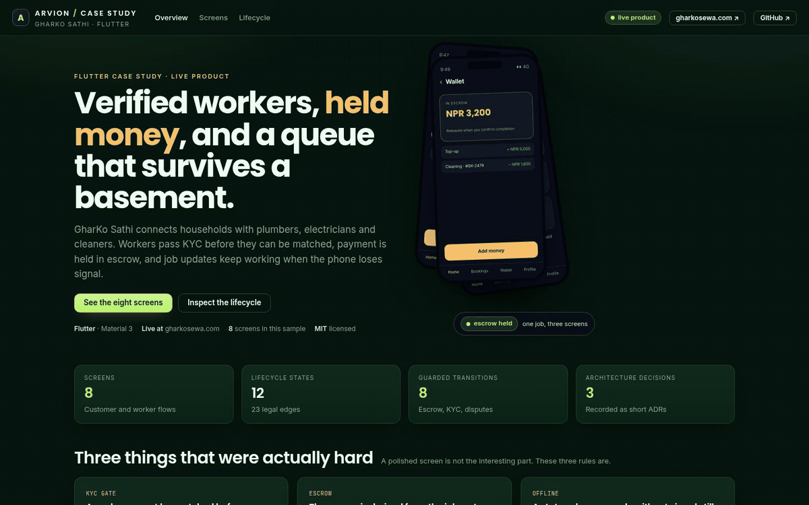
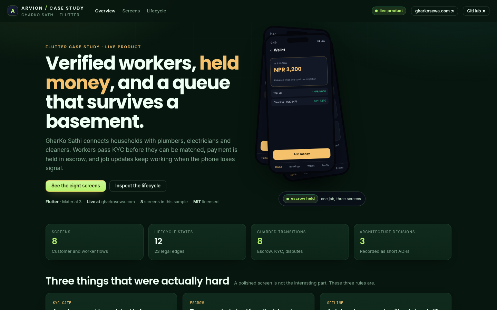
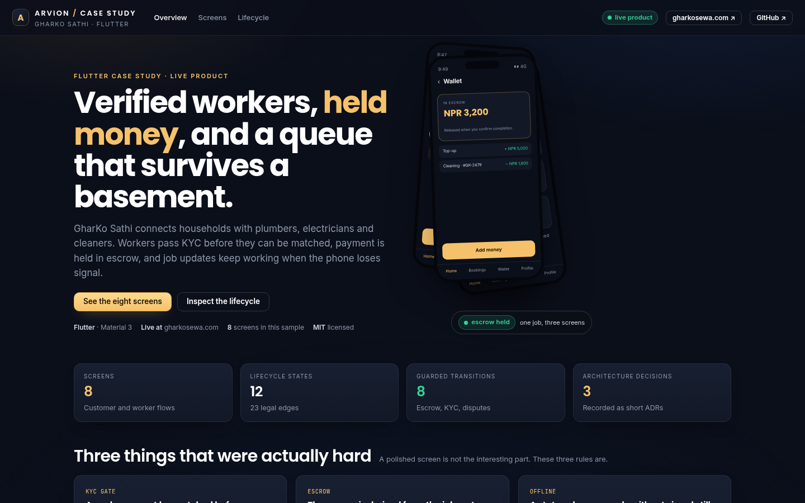

<div align="center">

</div>

<sub>Recorded from the live demo — <a href="docs/demo.mp4">MP4</a> · <a href="docs/screenshot.png">static frame</a></sub>

# GharKo Sathi

Architecture case study from GharKo Sathi, a home-services platform that runs in
production at [gharkosewa.com](https://gharkosewa.com). Households book verified
plumbers, electricians and cleaners; workers pass KYC before they can be matched;
payment is held in escrow until completion is confirmed. This repository is the
architecture sample, not the published app binary.

[**Open the live case study**](https://arvion-technology.github.io/labs/demos/gharkosathi-app/) · [MIT](LICENSE)

---

The interesting part of a services app is not the booking form. It is what
happens when a worker loses signal in a stairwell, when a customer disputes a job
after the money moved, or when an unverified worker should not appear in a
matching pool at all. The production app is Flutter; this repo carries the real
feature structure and the two pieces of logic that took the most care: the job
lifecycle and the offline queue.

The case-study site renders the eight screens from the same records the tests
check, and it lets you drive the offline queue yourself. The product is live;
this repository does not claim an App Store or Play Store listing because there
is no store link to give.

## What it does

- **Eight Flutter screens** — splash/session, service catalogue, booking, worker
  profile, worker KYC, job tracking, wallet and escrow, and dispute.
- **A twelve-state job lifecycle** — requested, matching, matched, en route, in
  progress, completed, paid, disputed, refunded, cancelled and closed, with
  twenty-three legal edges and eight guards.
- **KYC-gated matching** — a worker record carries a `KycState`; matching filters
  on `isVerified`, so an unverified worker cannot appear as bookable.
- **Escrow derived from the job** — held, releasable, released and frozen are
  computed from the status, so the wallet and the timeline cannot disagree.
- **An ordered offline queue** — idempotency keys, stop-on-first-failure,
  exponential backoff, JSON persistence across a process kill.
- **A case-study site** — a device-frame gallery of all eight screens, the
  lifecycle diagram, a live offline-queue simulator and a derived escrow table.
- **Written architecture** — `docs/architecture.md` plus three ADRs recording the
  decisions that shaped the code, including what was deliberately left out.

## Screenshots

| Overview | Lifecycle and offline queue |
| --- | --- |
|  |  |

The screens view is one click away in the demo (`#/screens`): all eight frames are
rendered from `src/product-data.js`, not screenshotted.

## Architecture

```text
28-gharkosathi-app/
├── lib/                         Flutter app source (1,877 lines)
│   ├── main.dart, app.dart      entry point, MaterialApp shell
│   ├── router.dart              named routes with typed arguments
│   ├── theme/                   brand colours → Material 3 theme
│   ├── core/                    no Flutter imports in this layer
│   │   ├── models.dart          Service, Worker, Job, WalletEntry, Dispute, Quote
│   │   ├── state_machine.dart   edges, guards, immutable transitions
│   │   ├── offline_queue.dart   ordered idempotent queue
│   │   ├── repository.dart      abstract boundary + in-memory implementation
│   │   └── mock_data.dart       seeded services and workers
│   └── screens/                 eight screens, one file each
├── src/                         JavaScript mirror used by the case-study site
│   ├── state-machine.js         same table and guards as the Dart class
│   ├── offline-queue.js         same queue rules
│   ├── product-data.js          screen records and architecture notes
│   └── app-metrics.js           metrics derived from the modules above
├── test/
│   ├── core.test.js             17 node:test cases
│   ├── state_machine_test.dart  pure Dart tests against shared vectors
│   ├── offline_queue_test.dart  pure Dart queue tests
│   └── vectors/job_flow.json    the contract both languages read
├── docs/                        architecture, 3 ADRs, screenshots
└── demo/                        static case study site
```

`lib/core` imports no Flutter widgets. That is deliberate: the state machine and
queue can be tested with `dart` alone, and the JavaScript mirror can share the
same vectors.

## Quickstart

The case-study site runs with no install:

```bash
git clone https://github.com/arvion-technology/gharkosathi-app.git
cd gharkosathi-app
npm test          # 17 JavaScript cases
npm run demo      # http://localhost:4173/demo/
```

The Flutter sample is a real project. It resolves offline if the Flutter SDK is
cached, and it has no third-party dependencies in `lib/`:

```bash
flutter pub get
flutter analyze lib
dart test/state_machine_test.dart
dart test/offline_queue_test.dart
```

Both Dart test files use a tiny harness in `test/support/harness.dart`, so they
run without `package:test` and without a network fetch.

## How it works

**The lifecycle is a table, not a screen switch.** `JobStateMachine.edges` maps
each status to its legal targets. `canTransition()` checks the edge and then the
guards; `transition()` returns a new `Job` with an appended `JobEvent`, so the
customer timeline and the audit record are the same data. Escrow is not a second
balance: `Job.escrow` is derived from the status, which is why the wallet cannot
show a released payment on an open job. The full table and the guarded edges are
in `docs/architecture.md`.

**The queue prefers correctness over speed.** Each mutation becomes an operation
with a key, a type and a payload. Enqueue deduplicates by key. Flush sends in
order and stops at the first failure, so a queued "completed" update can never
overtake a queued "in progress" one. Failure increments the attempt count and
schedules 1s → 2s → 4s → 8s, capped at 30s. After five attempts the operation is
marked exhausted and the UI offers to discard it instead of retrying forever. The
queue serialises to JSON and is restored before the first screen paints.

**KYC is its own state machine.** `notStarted → documentsUploaded → inReview →
verified | rejected`. A rejected application can resubmit without losing captured
documents. The worker badge reads `Worker.isVerified`, and the repository filters
matching on it, so the UI cannot accidentally present an unverified worker as
bookable.

**The site and the app share test vectors.** `test/vectors/job_flow.json` lists
the states, edges, forbidden pairs, guard contexts and three complete flows. The
Dart tests and the JavaScript mirror both read it; change a lifecycle rule in one
implementation and the other side fails before it can drift.

**What the sample leaves out is stated, not implied.** The production app uses
Riverpod and a declarative router. This sample uses plain `StatefulWidget` screens
and `onGenerateRoute` so the repository analyses with no external packages
(`docs/adr/0003-no-third-party-state.md` explains the trade-off). The HTTP
repository, secure token storage, document upload and payment gateway are also
not included.

## Tests

```bash
npm test                                  # 17 JavaScript cases
dart test/state_machine_test.dart         # 8 pure Dart cases
dart test/offline_queue_test.dart         # 7 pure Dart cases
flutter analyze lib                       # no issues
```

The JavaScript suite covers: transition-table parity with the vectors, forbidden
edges, every guard context, the three end-to-end flows, immutability, escrow
derivation, queue deduplication and ordering, backoff, exhaustion, persistence
and discard, the screen records mapping to real Dart files, and the derived
metrics. The Dart suites cover the same lifecycle and queue rules against the
same JSON, so the two implementations cannot diverge silently.

## Limitations

- This is not the published app. Store binaries and links are not claimed; the
  live service is at gharkosewa.com.
- The backend is not in this repository. `InMemoryRepository` returns seeded data
  with a small latency so the screens exercise loading states.
- Payments are represented by escrow states, not by a payment-provider
  integration.
- The worker KYC flow simulates capture. Camera access, upload and the reviewer
  console are product-side concerns that the sample deliberately excludes.
- Riverpod and the production router are replaced in the sample. The ADR says so
  rather than pretending the sample is the whole production architecture.

## Project layout

```text
28-gharkosathi-app/
├── lib/                    Flutter source (models, state machine, queue, screens)
├── src/                    JS mirror for the case-study site and node tests
├── test/                   node:test suite + pure Dart tests + shared vectors
├── docs/
│   ├── architecture.md
│   ├── adr/0001-lifecycle-in-pure-class.md
│   ├── adr/0002-offline-queue-idempotency.md
│   ├── adr/0003-no-third-party-state.md
│   └── screenshot*.png
├── demo/                   static case study: screens gallery, lifecycle, queue demo
├── pubspec.yaml
└── scripts/                serve, shot, static checks
```

## Credits

Built by [Arvion Technologies](https://arviontech.net) in Kathmandu. GharKo Sathi
is a live product of ours; we published the architecture because the KYC gate and
the escrow state machine are the parts other people building similar services ask
about. MIT licensed.
